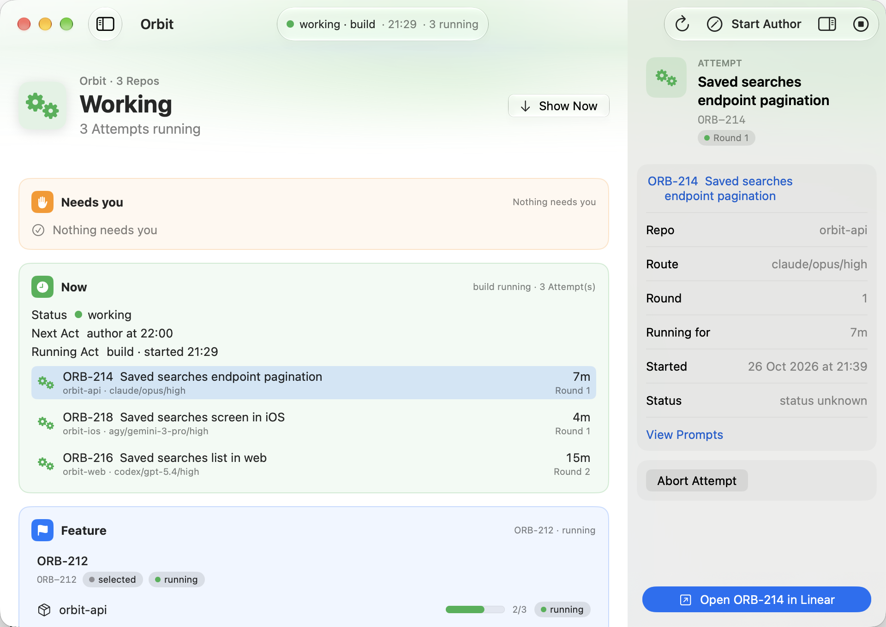

<p align="center">
  
</p>

<h1 align="center">Yellowhammer</h1>

<p align="center"><strong>Wake up to progress.</strong></p>

<p align="center">
  Give your coding agents a night shift.<br>
  Yellowhammer coordinates work from Linear across your Project’s repositories,<br>
  moving it toward reviewed pull requests while you’re away.
</p>

<p align="center">
  <a href="https://github.com/summerhammer/yellowhammer/releases/latest/download/Yellowhammer.dmg"><strong>Download for macOS</strong></a><br>
  macOS 26 · Apple Silicon
</p>

<picture>
  <source media="(prefers-color-scheme: dark)" srcset="doc/images/pulse-attempts-dark.png">
  <source media="(prefers-color-scheme: light)" srcset="doc/images/pulse-attempts-light.png">
  
</picture>

## Make progress overnight

Your backlog shouldn’t depend on you keeping a terminal company. Yellowhammer takes work from
Linear, routes it to coding agents, and coordinates implementation and review. Come back to see
what moved forward and what needs your attention.

## Move your whole Project forward

A feature can touch an API, an app, and a website. Group their repositories into one Project so
Yellowhammer can coordinate the work and bring the results back as a pull request per repository.

## Put your existing agents to work

Use your authenticated coding agent CLIs and choose routes for different kinds of work. Give
routine tasks and harder problems the agents and models you want handling them.

## Keep the final say

Set limits on Attempts and review Rounds before a Night begins. The Pulse shows running work
and what needs you, with links back to Linear. Yellowhammer opens pull requests for your review;
you decide what merges.

## Start your first Night

You’ll need an Apple Silicon Mac running macOS 26 or later, Linear, Orca ADE, and at least one
installed, authenticated supported coding agent CLI.

[**Download Yellowhammer**](https://github.com/summerhammer/yellowhammer/releases/latest/download/Yellowhammer.dmg)
· [Release notes](https://github.com/summerhammer/yellowhammer/releases/latest)

## For contributors and operators

See [CONTRIBUTING.md](CONTRIBUTING.md) for workstation prerequisites and the contribution workflow.

<details>
<summary>Build, test, and repository layout</summary>

The Yellowhammer macOS app and its Engine ship as one Developer ID signed `.app`, distributed
directly. The app is a bounded local control surface; the Engine (`yh`) runs short-lived
`author | build | land` invocations, each scoped to exactly one Project. Apple Silicon only.

## Layout

- **`Yellowhammer/`** — the app target (SwiftUI, not sandboxed).
- **`Engine/`** — the `Engine` command-line target, product `yh`, embedded in the app at
  `Contents/MacOS/yh`.
- **`Packages/YellowhammerKit/`** — all logic, as a local Swift package tested with Swift Testing.
- **`Yellowhammer.xcodeproj`** — a thin project holding only the two targets above.
- **`scripts/ci/`** — the checks CI runs; each can be run locally.

## Build, test, lint

```bash
swift test --package-path Packages/YellowhammerKit
xcodebuild -project Yellowhammer.xcodeproj -scheme Yellowhammer build
swiftlint lint --strict
```

## Toolchain (pinned in CI)

| Tool | Version |
|------|---------|
| CI runner image | `macos-26` (arm64); lint runs on `ubuntu-latest` |
| Xcode | 26.6 (17F113) |
| Swift | 6.3.3 (bundled with Xcode 26.6) |
| SwiftLint | 0.65.0 |

`.github/workflows/ci.yml` is the source of truth (`XCODE_VERSION`, `SWIFTLINT_VERSION`). Change this
table in the same commit as the workflow.

</details>

<details>
<summary>Product spec and traceability</summary>

## Relationship to the spec

The authoritative product spec lives in a separate repository, checked out next to this one as
`../yellowhammer-spec`. It is **read-only from here**:

- Read it at the time you need it (the `spec` MCP server, or the repo directly). Do not copy spec
  content into this repo.
- Never edit the spec from this repo. If it is wrong or incomplete, propose the change to its owners.
- A pull request titled `feat`, `fix`, `perf` or `revert` carries `Spec: <epic>/<story> @ <spec commit sha>`,
  or `Spec-Exempt: <reason>` when it implements no story. CI checks for one of them. Other title types
  and release PRs need neither.

</details>

<details>
<summary>Repair a Project’s Linear board after an upgrade</summary>

## Repair a Project's Linear board after an upgrade

When an Act or the Health card reports missing provisioned states or labels, choose **Repair**
in that Project's Health card, or run:

```sh
yh doctor --fix --check linear --project <id>
yh doctor --check linear --project <id>
```

Repair creates missing items and leaves existing ones alone. Repeating it is safe; it never
renames or deletes an item and does not install or change LaunchAgents. Omit `--project` to
repair every configured Project. Ordinary `yh doctor` remains read-only. A collision or refused
create is reported as unfinished and needs the action named in the report.

</details>
